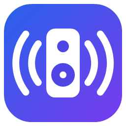
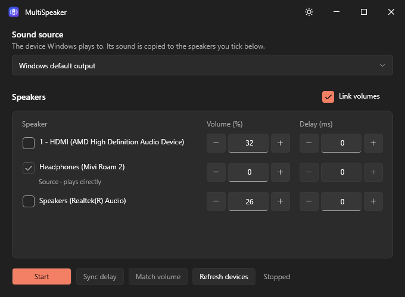

<p align="center">
  
</p>

<h1 align="center">MultiSpeaker</h1>

<p align="center">
  Play your PC's sound on several Bluetooth speakers at the same time, in sync.
</p>

<p align="center">
  
</p>

Windows can connect several Bluetooth speakers, but it only plays sound on one of them. MultiSpeaker copies whatever Windows is playing to the other speakers too, and keeps them in time with each other.

## Features

- **Play on several speakers at once.** Tick the speakers you want, then press **Start**.
- **Per-speaker delay.** Bluetooth speakers lag by different amounts (often 100–300 ms). Delay the faster ones so everything lines up. Changes apply instantly.
- **Sync delay.** Uses your microphone to measure each speaker and set its delay automatically.
- **Match volume.** Uses your microphone to make every speaker as loud as the source speaker.
- **Link volumes.** Change one speaker's volume (or use your keyboard volume keys) and the others follow by the same ratio.
- **Stays in sync.** Small differences between the speakers' clocks are corrected continuously, so they don't drift apart over long sessions.
- **Recovers by itself.** If a speaker disconnects and comes back, or you change the Windows default output, playback picks up again.
- **Light and dark theme**, a tray icon, and remembered settings.

## Download

Get the latest version from the [**Releases**](../../releases/latest) page.

| File | Size | Needs .NET installed? | Choose it if… |
|---|---|---|---|
| `MultiSpeaker-…-standalone.exe` | ~70 MB | No | You just want it to work. **Recommended.** |
| `MultiSpeaker-…-standalone-uncompressed.exe` | ~165 MB | No | You want the lowest RAM use (about 60 MB less). |
| `MultiSpeaker-…-portable.zip` | Small | Yes, the [.NET 10 Desktop Runtime](https://dotnet.microsoft.com/download/dotnet/10.0) | You already have .NET 10 and want a small download. |

**Requirements:** Windows 10 or 11 (64-bit) and a Bluetooth adapter. Sync delay and Match volume also need a microphone, such as a laptop's built-in mic.

> **SmartScreen warning?** The app isn't code-signed, so Windows may say it "protected your PC". Click **More info → Run anyway**.

## Quick start

1. **Connect your speakers** in Windows Settings → Bluetooth & devices.
2. **Make the slowest speaker the Windows default output.** That speaker plays the sound directly and can't be delayed, so it should be the one that lags most. If you don't know which one that is, pick any; **Sync delay** will tell you if you should switch.
3. Open MultiSpeaker. Leave **Sound source** on *Windows default output*.
4. **Tick the other speakers** and press **Start**.
5. **Pause your music**, place the laptop where you sit, and press **Sync delay**, then **Match volume**.
6. Turn on **Link volumes** if you want one volume control for all speakers.

You can always fine-tune by ear with the **−/+** buttons next to each speaker's volume and delay.

## How it works

```
 Apps (Spotify, YouTube, games…)
              │
              ▼
   Windows default output (source speaker) ──► plays directly
              │
              │  WASAPI loopback capture
              ▼
         MultiSpeaker
    ┌─────────┼─────────┐
    ▼         ▼         ▼
 Speaker B  Speaker C  …     each with its own delay buffer
```

- Audio is captured with WASAPI loopback and played on each extra speaker through its own WASAPI stream.
- Each speaker has a buffer that holds back the sound by its delay setting. The playback speed is adjusted very slightly (±0.5% at most, which you can't hear) to keep that buffer level steady. This cancels out the small clock differences between devices.
- **Sync delay** and **Match volume** play a short chirp (a quick rising tone) and listen with the microphone. The chirp travels the same path as your music, so the measurement includes each speaker's Bluetooth delay and volume.

## Tips and troubleshooting

| Problem | What to try |
|---|---|
| Stuttering or crackling | Your Bluetooth adapter is overloaded. Two speakers usually work well; three or more can be too much. Move the speakers closer to the PC or put Wi-Fi on 5 GHz. |
| One speaker is still slightly ahead or behind | Fine-tune its delay by 10 ms steps, or run **Sync delay** again with the room quiet. |
| "Still … ms late at 0 ms delay" | That speaker is slower than the source. Make it the Windows default output instead. |
| A speaker sounds quiet even at 100 % | Turn up the speaker's own volume buttons, or lower the source speaker and run **Match volume** again. |
| "Couldn't hear …" during Sync delay or Match volume | Check that the microphone is on, turn the speakers up, and keep the laptop near them. |
| Want every speaker to be adjustable | Set the Windows default output to a virtual device you don't listen to (for example VB-CABLE), choose it as the sound source, then tick all real speakers. |

## Build from source

You need the [.NET 10 SDK](https://dotnet.microsoft.com/download/dotnet/10.0) on Windows.

```powershell
dotnet run                                       # build and start
dotnet publish -p:PublishProfile=SingleFile      # one standalone exe in publish/
```

### Releasing

1. Add a `## vX.Y.Z` section to [CHANGELOG.md](CHANGELOG.md). It becomes the release's highlights.
2. Push a tag with that version. This builds all three downloads plus `SHA256SUMS.txt` and publishes a GitHub release:

```powershell
git tag -a v1.0.0 -m "MultiSpeaker v1.0.0"
git push origin v1.0.0
```

Every push and pull request is also built, and the files are attached to the workflow run as artifacts. See [.github/workflows/build.yml](.github/workflows/build.yml).

### Project layout

| File | What it does |
|---|---|
| `AudioRouter.cs` | Captures the source with WASAPI loopback and fans it out to the speakers |
| `SpeakerOutput.cs` | Per-speaker delay buffer, drift correction and playback |
| `SyncCalibrator.cs` | Microphone measurement behind Sync delay and Match volume |
| `MainWindow.xaml(.cs)` | Window, custom title bar, tray icon, device handling |
| `SpeakerRow.cs` | One speaker in the list: tick box, volume, delay |
| `NumberBox.xaml(.cs)` | The −/+ number box |
| `ThemeManager.cs` | Light and dark theme |
| `DeviceWatcher.cs` | Listens for speakers connecting and disconnecting |
| `AppSettings.cs` | Settings saved in `%APPDATA%\MultiSpeaker` |

## Acknowledgements

Built with [NAudio](https://github.com/naudio/NAudio) for Windows audio (WASAPI) access. See [THIRD-PARTY-NOTICES.txt](THIRD-PARTY-NOTICES.txt).

## License

[MIT](LICENSE) © 2026 Prabin
